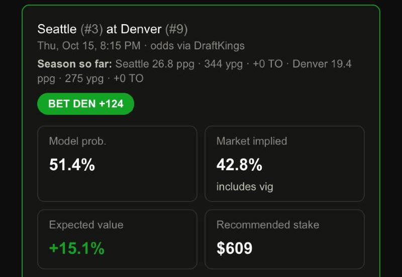

# Edge Calculator

**Live app:** https://bet-edge-app.netlify.app

A sports analytics tool for NFL and college football that answers one question honestly: *is this price actually good?* It compares a home-built win-probability model against live sportsbook odds, sizes every edge with the Kelly criterion, and shows what that does to a bankroll over time.



## Highlights

- **Its own model, not the market's.** Elo ratings, team-stat features, and a starting-QB signal feed a logistic regression written from scratch with no ML library. It is trained on the oldest 80% of games and scored only on the newest 20% it never saw.
- **Measured, not claimed.** Brier score, a calibration chart, and a walk-forward backtest (flat vs. full Kelly vs. half Kelly) are shown in the app itself.
- **Built-in skepticism.** When the model disagrees with a real sportsbook by too much, the pick is flagged as a likely model blind spot instead of shown as "free money."
- **Honest growth math.** It shows the real compounding rate `g = μ − σ²/2` next to the average return, and defaults to half-Kelly because real probability estimates carry error.
- **Trends that count the vig.** Every trend is measured against the real closing line and needs 30+ games before it is marked trusted, which shuts down the usual cherry-picking.
- **$0 to host.** A static Next.js export on Netlify, with data refreshed by scheduled GitHub Actions. 358 unit tests cover every math and data module.

**Stack:** Next.js · TypeScript · Tailwind · Vitest · GitHub Actions · Netlify · nflverse / cfbfastR data · The Odds API

Built by [Jason McElvain](https://github.com/MacSupportPlus). For research and education, not betting advice. If gambling stops being fun, call 1-800-GAMBLER.

---

## Core idea

This app does **not** predict outcomes with certainty. What it does:

- trains a transparent, auditable probability model on real historical games
  (no vegas lines used as an input),
- turns a probability (yours or the model's) plus market odds into a real
  expected-value check and a Kelly-sized stake,
- gives you the raw data — every team, every player, every game, every
  situational trend — to research a pick yourself instead of only trusting
  the model's own number, and
- tracks what actually happens to a bankroll over time, honestly, including
  the difference between the ensemble average outcome and what a single real
  bettor experiences.

The central theme, made visible throughout the UI: the **average** outcome
across many hypothetical parallel bettors is not what any single bettor
actually experiences. The real, single-path compounding rate is

```
g = μ - σ²/2
```

always lower than the naive average return — variance is the thing eating the
difference. Kelly-optimal sizing maximizes this long-run geometric growth
rate, not the average.

Because real probability estimates always carry error (a "55% edge" might
actually be 50.5%), and Kelly has no concept of that uncertainty, the app
defaults to **fractional Kelly** (½-Kelly) rather than full Kelly — trading
some growth rate for protection against a wrong `p`.

## Navigation

Five top-level destinations, two of which are families of tools sharing a
second row of tabs rather than one page each:

| Destination | What's there |
|---|---|
| **Home** | Command Center — starred teams/players with live context, an "Explore" grid to everything else |
| **Research** | Matchup, Team, Player, Games, This Week, Rankings, Props — seven sub-tabs, one shared model |
| **Trends** | Trusted Trends, Team Trends, Today, Build Your Own, My Trends |
| **Tracker** | Bets & CLV, Risk of Ruin, Edge Calculator |
| **Guide** | Plain-language walkthrough of every tool above, plus the Probability Model's full calibration backtest |

Implemented with two Next.js **route groups** — `src/app/(research)/` and
`src/app/(tracker)/` — so every URL is unchanged from before the grouping
(`(research)`/`(tracker)` don't appear in the path); each group has its own
`layout.tsx` rendering a shared sub-nav (`ResearchSubNav.tsx`/`TrackerSubNav.tsx`).

## The model

1. **Data**: real historical games pulled from two free, no-API-key public
   sources — [nflverse](https://github.com/nflverse/nfldata) (NFL, 1999–present)
   and [cfbfastR-data](https://github.com/sportsdataverse/cfbfastR-data)
   (college football, 2004–present), plus per-game player usage (passing/
   rushing/receiving/tackle leaders) and, for NFL, real historical spread/
   total lines, rest days, weather, and starting-QB names — all previously
   fetched and discarded by earlier versions of this pipeline, now kept.
   [`scripts/prepare-data.mjs`](scripts/prepare-data.mjs) builds
   `public/data/*.json`; re-run it (`node scripts/prepare-data.mjs`) any time
   to refresh with newer games. [`scripts/fetch-live-odds.mjs`](scripts/fetch-live-odds.mjs)
   separately pulls live multi-book odds and player props from
   [The Odds API](https://the-odds-api.com) on its own schedule.
2. **Feature engineering**: [`src/lib/elo.ts`](src/lib/elo.ts) replays every
   season chronologically, computing an Elo rating per team from nothing but
   final scores — each game's feature is the *pregame* Elo gap, so there's no
   leakage of the outcome it's predicting. [`src/lib/qbValue.ts`](src/lib/qbValue.ts)
   adds a walk-forward, shrinkage-regularized starting-QB value signal (NFL
   only, since only nflverse's archive carries per-game starting-QB names),
   injury-aware via ESPN's live report. [`src/lib/srs.ts`](src/lib/srs.ts)
   computes a completely independent Simple Rating System (margin-of-victory
   based, no home-field term) as a free "second opinion" alongside Elo on the
   Team and Rankings pages — retrospective only, never fed into the trained
   model.
3. **Model**: [`src/lib/logisticRegression.ts`](src/lib/logisticRegression.ts), a
   from-scratch batch-gradient-descent logistic regression (no ML library),
   trained on the earliest 80% of games and evaluated only on the most
   recent 20% it never saw. `src/lib/modelFeatures.ts` builds a consistent
   feature vector (Elo diff, team-stat diffs, QB value) shared by training
   and every live prediction, so they can never silently drift out of sync.
4. **Calibration**: [`src/lib/calibration.ts`](src/lib/calibration.ts) computes
   Brier score and a reliability diagram (predicted probability vs. actual
   win frequency, bucketed) on the held-out set, against a naive "always
   predict the training-set home-win rate" baseline.
5. **Backtest**: [`src/lib/backtest.ts`](src/lib/backtest.ts) replays the
   held-out games in order, comparing flat betting vs. full Kelly vs. half
   Kelly at an assumed standard -110.
6. **Spread/total**: [`src/lib/spreadModel.ts`](src/lib/spreadModel.ts) fits a
   linear margin/total point estimate, then turns it into a real cover/over
   probability two ways — a Normal-distribution fallback, and (once at least
   50 held-out residuals exist) an **empirical, distribution-free**
   probability straight from the actual historical residuals (a split-
   conformal-style approach), which correctly captures real skew a bell
   curve can't (e.g. rushing yards: only 44.4% of games beat a player's own
   trailing mean, not 50%). `historicalTotalResiduals()` computes this
   walk-forward (no-leakage) for totals for the first time — the point
   estimate existed before, but its accuracy was never validated
   walk-forward until this pass.
7. **Player props**: [`src/lib/playerProjection.ts`](src/lib/playerProjection.ts)
   projects passing/rushing/receiving yards from a player's own walk-forward
   season-to-date average, validated separately per category against a naive
   league-average baseline (rushing cuts error ~34%, receiving ~14%, passing
   ~10%) — real, disclosed, per-category numbers, not one blanket claim.

**A genuinely useful accident worth keeping in mind**: full-Kelly's backtest
bankroll figure can come out absurdly large over 1,000+ held-out games. That's
not a bug — it's raw Kelly math compounding a sustained edge for that many
consecutive bets, which assumes unlimited market depth at an unchanged price
for over a decade, something no real sportsbook would ever allow. Every bet
is hard-capped at 25% of the current bankroll regardless of Kelly's raw
recommendation. The **per-bet growth rate** (the same `g` above, backed out
of the backtest) is the honest number, shown right alongside the dollar
figure for exactly this reason.

## Research tools

- **This Week** — the model above, applied automatically: fetches this
  week's games and live odds, matches teams against the historical archive
  (`src/lib/teamMatch.ts` — exact match, alias table, normalized fallback;
  anything unmatched is skipped, never guessed), and surfaces only
  positive-EV picks. A big model/market disagreement (`src/lib/scanner.ts`'s
  `MAX_TRUSTED_DISAGREEMENT`/`MAX_TRUSTED_RATIO` guardrails) gets pulled into
  a separate "flagged" list instead of recommended or hidden — a big gap
  from a real sportsbook price is far more likely to mean the model missed
  something than that free money was found. A "report card" backtests the
  last 10 days' worth of real, already-decided games.
- **Team / Player pages** — a single team's or player's own deep-dive:
  rating trends, opponent-adjusted offense/defense, recent form, and for
  players a full stat history with a green/yellow/red hit-rate table
  (`src/lib/hitRate.ts`, Outlier.bet's own color convention), a recent-games
  bar chart, and every book's current prop line. Star either to pin it to
  Home (`src/lib/favorites.ts`).
- **Games** — the full season schedule (not just today's algorithmic picks),
  most current first, with a separate History view for past seasons, most
  recent first.
- **Rankings** — every team by current Elo, sortable by any column,
  including the independent SRS second opinion above; links to
  opponent-adjusted QB Rankings.
- **Props** — player prop edges through the exact de-vig + trust-guardrail
  pipeline moneyline picks use, reusing `src/lib/scanner.ts`'s `pickOverUnder`.

## Trends

`src/lib/situationalTrends.ts` — deliberately different from a typical trend
site: every result is measured against the real closing spread/total (not a
flat 50%, which lets "good teams cover more" masquerade as a real edge), and
every card shows Record, ROI%, cover/over rate, Units, current Streak, Last
10, Games, and Years (ROI/Units assume a flat 1-unit bet at standard -110,
disclosed, since there's no historical per-game price archive) plus a
cumulative-units sparkline. A trend needs 30+ decided games before being
marked **trusted** — most curated situations, measured honestly over their
full history rather than cherry-picked, actually show a small negative ROI
once real vig is counted, which is the correct, well-known truth that most
"trends" don't beat the vig.

- **Team Trends** (`src/lib/teamTrendPresets.ts`) — a preset battery of ~12
  angles (home/away, favorite/underdog, division, rest) run automatically
  for one chosen team.
- **Today** (`src/lib/todaysTrends.ts`) — cross-references live odds against
  every team playing right now, showing the exact matching curated trend for
  their real home/away + favorite/underdog spot before kickoff.
- **Build Your Own** (`src/lib/customTrends.ts`) — combine filters yourself;
  every combination still runs through the identical trust gate and ROI math
  as the curated list, closing the classic unlimited-filter-trend-builder
  p-hacking trap by construction instead of a disclaimer.
- **My Trends** (`src/lib/savedTrends.ts`) — a personal saved list,
  localStorage-backed like favorites, recomputed live rather than frozen.
  Scoped to one browser for now; a real shared feed where other people
  publish and discover trends too is a deliberately deferred feature — it
  needs an actual backend/database this static app doesn't have.

## Bankroll Tracker

Log real bets, settle them as win/loss (or let structured spread/total/props
bets — `src/lib/bankroll.ts`'s `BetEntry.betType`/`line`/`side` — auto-settle
against the final score via `src/lib/autoGradeBets.ts`), and compare two
bankroll paths side by side: **realized** (what actually happened) vs.
**theoretical** (the same picks/outcomes sized at recommended fractional-Kelly
instead) — isolating sizing discipline from pick quality. Also computes
**closing line value** (`src/lib/clv.ts`): whether a logged bet's price beat
the closing line, the standard skill signal sharp bettors track independent
of whether the bet actually won.

Data is saved to **this browser's localStorage only** — per-device, not
synced anywhere. That's a deliberate static-app tradeoff (no backend/auth),
not an oversight.

## Tech stack

Next.js (App Router, static export — `output: "export"`) + TypeScript +
Tailwind CSS. Every model, simulation, and backtest runs entirely
client-side — `public/data/*.json` is fetched once and everything else (Elo,
regression, calibration, backtesting, trend math) happens in the browser.
Live odds and props come from The Odds API (paid, low-volume tier). They are
fetched on a schedule by GitHub Actions (`.github/workflows/`), with the API key
stored as an encrypted repository secret, and written to static JSON, so the key
never reaches the browser. Injury reports come from ESPN's public API, fetched in
the browser. The historical archive refreshes daily and live odds every 2 hours.

Testing: [Vitest](https://vitest.dev) for every pure-math/data module — 358
tests as of this writing, one test file per lib module, no component tests
(this app tests statistical correctness, not UI rendering; every UI change
is verified manually against a live dev server instead).

## Getting started

```bash
npm install
npm run dev      # http://localhost:3000
npm run test     # unit tests for every lib module
npm run build    # production static export
npm run lint
```

`scripts/prepare-data.mjs` and `scripts/fetch-live-odds.mjs` need no API key
to run for the free historical archive; live odds/props need `ODDS_API_KEY`
(The Odds API) in `.env.local` — see `.env.example`.
